# AI Resume Builder

[](https://github.com/rajuerladinny/ai-resume-builder/actions/workflows/ci.yml)
[](LICENSE)
[](https://react.dev/)
[](https://fastapi.tiangolo.com/)
[](#privacy-and-safeguards)
[](https://rajuerladinny.github.io/ai-resume-builder/)

A free, open-source tool for job seekers and recruiters. Check whether applicant tracking systems can **read your resume file**, find the **jobs you fit best**, get a **match score**, **bullet-by-bullet advice**, a **tailored resume**, a **cover letter** and **interview questions**, download them as **Word or PDF**, and **track every application**. Recruiters can rank resumes with **anonymous screening**. Nothing is stored on the server, and it works without any AI model; connect one when you want AI rewriting.

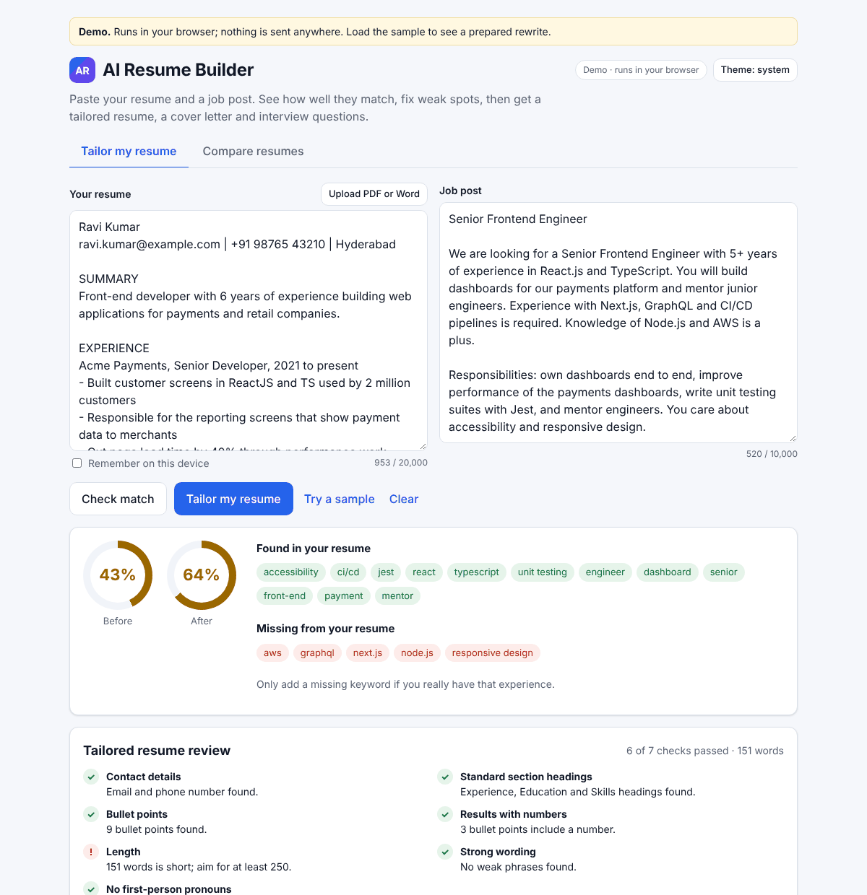

**▶ [Try the live demo](https://rajuerladinny.github.io/ai-resume-builder/)**: runs entirely in your browser, with no sign-up and nothing uploaded. Click **Try a sample** to see every feature.

> **Status:** v1.0, ready to self-host. The rule-based features (score, review, bullet coach, interview prep, template cover letters, comparison) are complete and tested. The AI rewrite and AI cover letter prompts work with any OpenAI-compatible model but have had limited tuning against real models, so always read AI output before sending it.

## Contents

- [Problems it solves](#problems-it-solves)
- [Features](#features)
- [How it works](#how-it-works)
- [Quick start](#quick-start)
- [Configuration](#configuration)
- [Deploy](#deploy)
- [API](#api)
- [Privacy and safeguards](#privacy-and-safeguards)
- [Development](#development)
- [Roadmap](#roadmap)
- [Limitations](#limitations)
- [Contributing](#contributing)
- [License](#license)

## Problems it solves

| Problem | How the app helps |
|---|---|
| "I apply and never hear back." Often the resume file can't be read by the company's screening software. | **ATS readability check** finds tables, text boxes, images, header-only contact details, broken characters and column layouts in your PDF or Word file. |
| "I'm applying everywhere and getting nowhere." | **Best-fit jobs** ranks up to 10 job posts by how well your resume fits, so you put effort where you're most likely to get a reply. |
| "Tailoring a resume takes an hour per application." | **Match score**, **bullet coach** and **tailored resume** show what's missing and fix it in minutes, without inventing experience. |
| "I lost track of where I applied and which resume I sent." | **My applications** tracks company, role, date, status, resume version and notes, with your interview rate. |
| "I don't know what they'll ask me." | **Interview prep** predicts questions from your skills, your gaps and the job post. |
| "Writing a cover letter for every job is draining." | **Cover letter** drafts one from your resume's own facts. |
| Recruiters: "Screening 50 resumes takes all day, and first impressions can be biased." | **Compare resumes** ranks up to 20 against the job post, with **anonymous screening** that hides names, contact details and personal details such as age or gender. |

## Features

### For job seekers

| Feature | What you get | Needs AI? |
|---|---|---|
| **ATS readability check** | After you upload a PDF or Word file: whether screening software can read it, with a fix for each problem (tables, text boxes, images, contact details only in the header, broken characters, columns, page count). | No |
| **Best-fit jobs** | Paste up to 10 job posts and see which ones your resume fits best, with the missing keywords for each, then tailor for any of them in one click. | No |
| **My applications** | A tracker for every application: company, role, date, status, link, resume version, notes and match score, with your interview rate, CSV export and backups. Saved only in your browser. | No |
| **Match score** | How well the resume covers the job post's keywords, as a percentage, with the keywords found and missing. Skills count double. | No |
| **Resume review** | Seven checks recruiters and applicant tracking systems care about: contact details, section headings, bullets, numbers, length, weak phrases and pronouns. | No |
| **Bullet coach** | Advice on each weak bullet point: a stronger verb to start with, a missing number, too long or too short. | No |
| **Interview prep** | Likely questions for this job, from the skills you show, the skills you lack and themes in the job post, each with an answering tip. | No |
| **Tailored resume** | Your resume rewritten for the job using only facts already in it, with a line-by-line changes view. Any job keyword the rewrite adds is flagged for you to check. | Yes |
| **Cover letter** | A letter for the job. With AI: written from your resume's facts, with added keywords flagged. Without AI: built from your own best-matching bullet points. | Optional |
| **Export** | Word (.docx), PDF and text downloads in a clean single-column layout that applicant tracking systems can read. | No |
| **Upload** | PDF, Word (.docx) or text files, read in memory and never stored. | No |
| **Remember on this device** | Opt-in: keeps your resume and job post in your own browser for next time. | No |
| **Light and dark themes** | Follows your system, or choose one. | No |

| ATS readability check | Best-fit jobs |
|---|---|
| 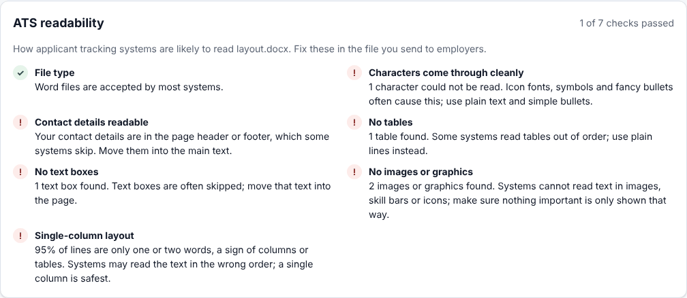 | 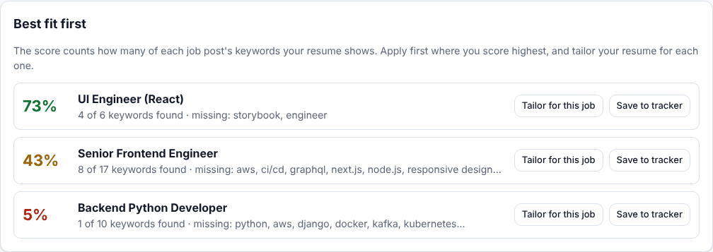 |

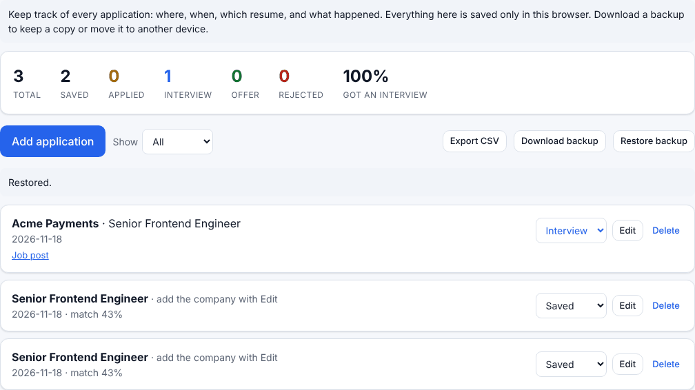

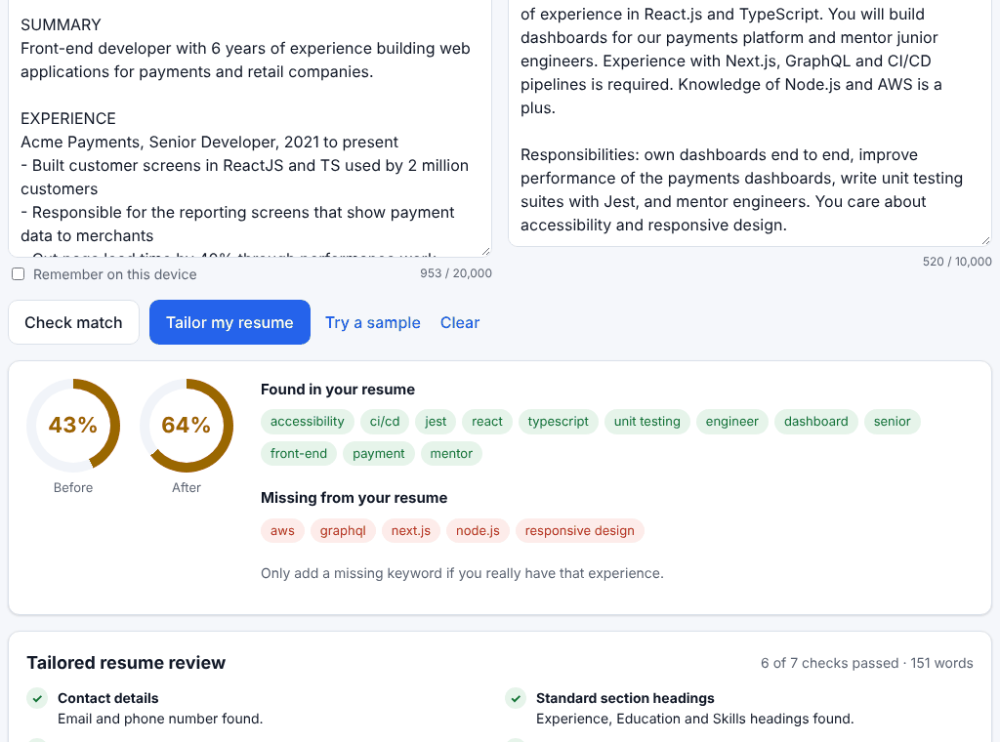

### For recruiters

**Compare resumes**: add one job post and up to 20 resumes to get a ranked table with each resume's score, missing keywords and review, plus CSV export. The score counts keyword overlap only, so treat it as a guide to what to read first, never as a decision about a candidate.

**Anonymous screening**: one tick replaces file names with "Candidate 1, 2, 3…" and lets you read each resume with the name, email, phone, links and personal details (date of birth, age, gender, marital status, nationality, religion, address) removed. Scores are always calculated on the full text, so turning it on or off never changes the ranking. Untick it once you have a shortlist.

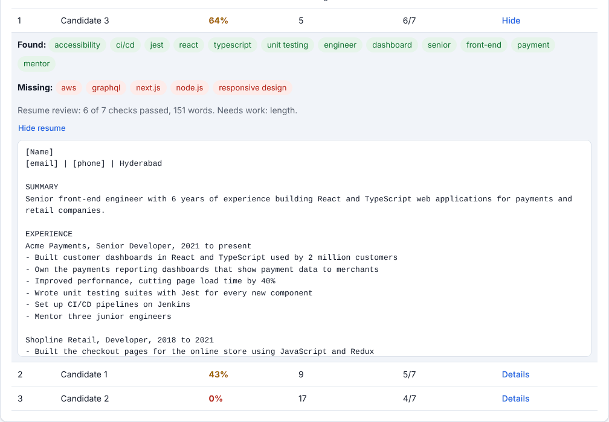

| Cover letter (dark theme) | PDF export |
|---|---|
| 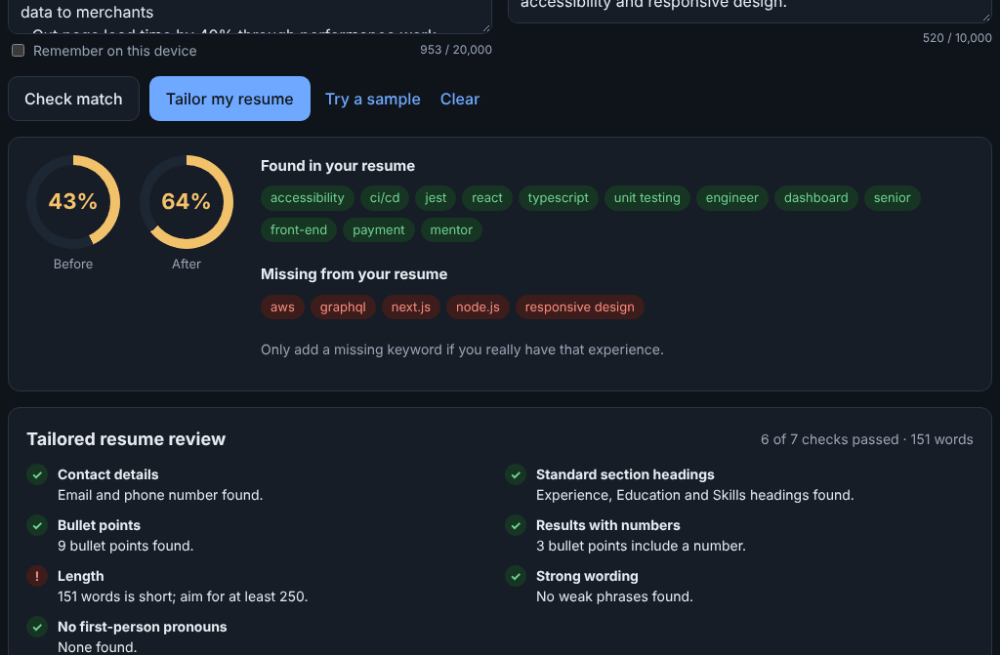 | 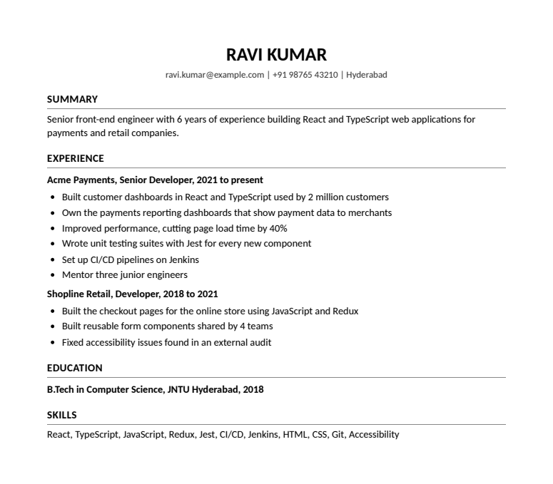 |

## How it works

### System overview

One React page talks to one FastAPI server. The server keeps nothing: every request is handled in memory. An AI model is optional and can be any OpenAI-compatible endpoint, hosted or local.

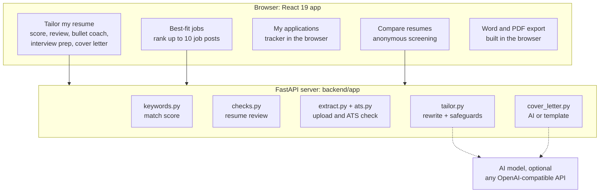

The public demo runs the same page with JavaScript ports of the scoring, review, upload and template code, so it needs no server at all. A shared fixture file (`fixtures/parity.json`) and tests on both sides keep the two implementations giving identical results.

### Flow: tailoring a resume

The AI is never trusted blindly. Its output is scored again, compared with the original, and replaced with the original if anything looks wrong.

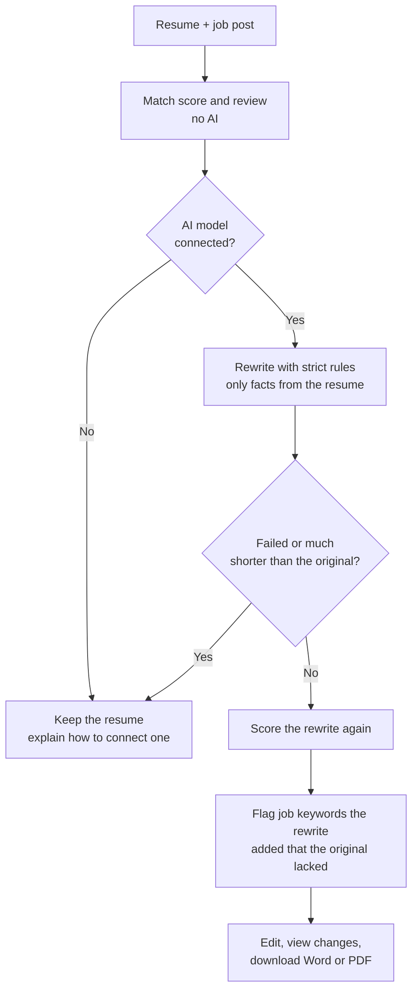

### Flow: writing a cover letter

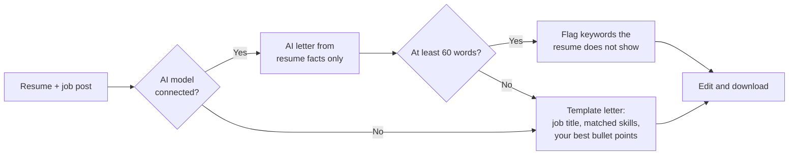

For a file-by-file map of the code, see [PROJECT_OVERVIEW.md](PROJECT_OVERVIEW.md).

## Quick start

### Run everything with Docker

```bash
docker build -t ai-resume-builder .
docker run -p 8000:8000 ai-resume-builder
```

Open http://localhost:8000. Without AI settings it runs in **mock mode**: every feature works except AI rewriting, and cover letters use the template. Interactive API docs are at http://localhost:8000/docs.

### Run for development

Requires Python 3.12+ and Node.js 20.19+.

```bash
# Terminal 1: the API
cd backend
python -m venv .venv && source .venv/bin/activate   # Windows: .venv\Scripts\activate
pip install -r requirements-dev.txt
uvicorn app.main:app --reload                        # http://localhost:8000

# Terminal 2: the page
cd frontend
npm install
npm run dev                                          # http://localhost:5173
```

The development page forwards `/api` calls to the API on port 8000.

### Run the demo only (no backend)

```bash
cd frontend && npm install && npm run dev
# open http://localhost:5173/?demo
```

## Configuration

All settings are environment variables. The API checks them at startup and refuses to start with a clear message if one is wrong. See [`backend/.env.example`](backend/.env.example); the app does not load `.env` files itself, so export them in your shell or set them on your host.

| Variable | Default | What it does |
|---|---|---|
| `LLM_PROVIDER` | `mock` | `mock` for no AI, or `openai` for any OpenAI-compatible chat API |
| `LLM_BASE_URL` | `http://localhost:11434/v1` | The API's base URL; the default is a local [Ollama](https://ollama.com) server |
| `LLM_MODEL` | none | Model name as your provider lists it. Required when `LLM_PROVIDER=openai` |
| `LLM_API_KEY` | `none` | Your provider key. Any value works for local servers |
| `LLM_TIMEOUT` | `90` | Seconds to wait for the model |
| `ANALYZE_LIMIT` | `60` | Match checks and comparisons per visitor per hour |
| `TAILOR_LIMIT` | `10` | Rewrites and cover letters per visitor per hour (these cost AI money) |
| `EXTRACT_LIMIT` | `120` | File uploads per visitor per hour |
| `TRUST_PROXY` | off | Set to `1` behind a reverse proxy you control, so limits apply per visitor |
| `CORS_ORIGINS` | `http://localhost:5173` | Comma-separated origins allowed to call the API from another site |
| `PORT` | `8000` | Port inside the Docker container |

**Connect a free local model:** install Ollama, run `ollama pull llama3.2`, then start the API with `LLM_PROVIDER=openai LLM_MODEL=llama3.2`.

## Deploy

| Option | What runs | Cost | Guide |
|---|---|---|---|
| **GitHub Pages** | The in-browser demo only (no AI) | Free | Run the **Deploy demo** workflow after enabling Pages (Settings → Pages → Source: GitHub Actions) |
| **Render** | The full app from the Docker image | Free plan available | [`render.yaml`](render.yaml) blueprint; see [docs/DEPLOYMENT.md](docs/DEPLOYMENT.md) |
| **Any Docker host** | The full app | Varies | `docker run -p 8000:8000 -e TRUST_PROXY=1 ai-resume-builder` |

Always serve the full app over HTTPS, and name your AI provider in your privacy notice if you connect one. More detail, including a production checklist, is in [docs/DEPLOYMENT.md](docs/DEPLOYMENT.md).

## API

Interactive docs are served at `/docs`. All `POST` bodies are JSON except `/api/extract`.

| Method and path | Body | Returns |
|---|---|---|
| `POST /api/analyze` | `{resume, job}` | Match score, matched and missing keywords, review |
| `POST /api/tailor` | `{resume, job}` | Tailored resume, scores before and after, flagged keywords, review |
| `POST /api/cover-letter` | `{resume, job}` | `{letter, ai, notice, check}` |
| `POST /api/rank` | `{job, resumes: [{name, text}]}` (up to 20) | Ranked results with reviews |
| `POST /api/rank-jobs` | `{resume, jobs: [{name, text}]}` (up to 10) | Job posts ranked by fit, with matched and missing keywords |
| `POST /api/extract` | The file's raw bytes (PDF, .docx or text, up to 5 MB) | `{text, characters, ats}`, where `ats` is the readability check |
| `GET /api/health` | none | `{ok, version, ai}`, where `ai` is `"ai"` or `"mock"` |

Resumes must be 100 to 20,000 characters and job posts 100 to 10,000. Limits return HTTP 429; invalid input returns 422 with a readable message.

## Privacy and safeguards

- **Nothing is stored on the server.** Resumes, job posts and files are handled in memory for one request. API responses are sent with `Cache-Control: no-store`.
- **Logs never contain resume text.** AI failures are logged by error type only.
- **No invented experience.** The AI is instructed to use only facts from the resume, and every job keyword that appears in AI output but not in the original resume is shown to the user to check.
- **Safe fallbacks.** If the model fails, times out or returns something much shorter than the original, the user gets their original resume or the template letter, never an error page or a truncated document.
- **Abuse limits.** Per-visitor hourly limits, a 5 MB upload cap, a 15-page PDF cap and request size limits.
- **Hardened container.** Runs as an unprivileged user, writes nothing to disk, and has a health check. Security headers (`nosniff`, `DENY` framing, no referrer) are on every response.
- **"Remember on this device" is opt-in** and keeps data only in the visitor's own browser; unticking it deletes it. **My applications** is also stored only in the browser, with backup files the visitor controls.
- **Anonymous screening never changes scores**: ranking always uses the full text; only what the reviewer sees is redacted.
- **AI providers.** With an AI model connected, resume text is sent to that provider. Choose one whose data terms suit you, or run a local model.

To report a security issue privately, see [SECURITY.md](SECURITY.md).

## Development

```bash
cd backend && ruff check . && python -m pytest -q      # lint and Python tests
cd frontend && npm test                                # JavaScript tests
cd frontend && npm run build && npm run build:demo     # production and demo builds
```

The demo runs JavaScript ports of the scoring, review and template cover letter code. After changing `keywords.py`, `checks.py`, `tailor.py`, `cover_letter.py`, `extract.py` or `ats.py`, run `python -m app.export_shared` in `backend/`; tests on both sides fail until the two give the same results.

CI runs on every push and pull request: lint, both test suites, both frontend builds, and a Docker build that checks the container serves the page, the API and a cover letter as an unprivileged user. Dependabot proposes dependency updates monthly.

## Roadmap

- [x] Match score, resume review, tailored resume and changes view
- [x] PDF, Word and text upload
- [x] Compare up to 20 resumes against one job post
- [x] In-browser demo with no server
- [x] Cover letters (AI or template), bullet coach, interview prep
- [x] Word and PDF export, light and dark themes, opt-in saving on the device
- [x] Docker image, Render blueprint, CI with lint and container checks
- [x] ATS readability check, best-fit jobs, application tracker, anonymous screening
- [ ] Tune the AI prompts against several open and hosted models
- [ ] Skill lists for roles beyond software (sales, finance, healthcare, design)
- [ ] Section-aware rewriting, so employers and dates can never change
- [ ] Browser tests for the React page
- [ ] Optional accounts, so saved resumes and the tracker sync across devices
- [ ] More languages

Have an idea? Open an [issue](https://github.com/rajuerladinny/ai-resume-builder/issues).

## Limitations

- The match score counts keywords. It does not judge experience, and the comparison table should never be the only reason to reject anyone.
- The skill list in `keywords.py` covers software and IT roles; other fields score less precisely.
- The resume review uses fixed rules, so unusual layouts can be misjudged.
- Scanned PDFs (images of text) cannot be read; paste the text instead. Old `.doc` files are not supported.
- In the demo, PDFs are read with pdf.js, which can order multi-column text differently from the server.
- The ATS check reads the file's structure with rules. Real systems differ, so a pass is a good sign, not a guarantee. Column detection is a heuristic based on many very short lines.
- Anonymous screening removes common identifying details but cannot catch everything, such as a name written only inside a project description or a college that hints at background.
- My applications lives in one browser. Clearing site data deletes it, so download a backup now and then.
- Rate limits are per IP address and held in memory, so they reset on restart and assume a single server process.
- AI output can still be wrong even with the safeguards. Read everything before you send it.

## Contributing

Contributions are welcome, including from first-timers. Read [CONTRIBUTING.md](CONTRIBUTING.md) for setup and pull request guidelines. Please use made-up resumes in issues, tests and screenshots, never a real person's.

If this project is useful to you, consider giving it a ⭐.

## License

[Apache License 2.0](LICENSE). Copyright 2026 Raju Erladinny.
