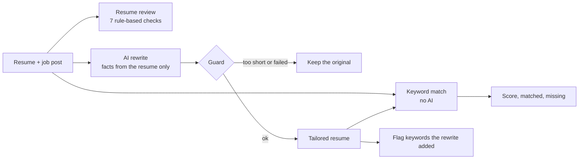

# AI Resume Builder

[](https://github.com/rajuerladinny/ai-resume-builder/actions/workflows/ci.yml)


Paste or upload a resume and a job post; get a match score, missing keywords,
a resume review and a version tailored to that job, with one-click PDF export.

**Live demo:** https://rajuerladinny.github.io/ai-resume-builder/ (runs in the browser with sample data; no login)

**Status:** working prototype. The rewrite prompt has not been tuned against a
real model yet. See [PLAN.md](PLAN.md) for the product plan, pricing and roadmap.

## What it does

- **Match score** from the job post's keywords, calculated without AI, so it
  is instant, free and repeatable. Skills count double.
- **Resume review**: seven rule-based checks (contact details, section
  headings, bullets, results with numbers, length, weak phrases, pronouns),
  each with a plain instruction for fixing it.
- **Upload** a PDF, Word (.docx) or text file instead of pasting. Files are
  read in memory and never stored.
- **Tailored resume** from an AI model that is told to use only facts already
  in the resume. Any job keyword that appears in the rewrite but not in the
  original is flagged for the user to check.
- **Show changes**: a line-by-line view of what the rewrite added and removed.
- **Export**: copy, download as text, or save as PDF.
- **Compare resumes** (for recruiters): add one job post and up to 20 resumes
  at once to get a ranked table with each resume's score, missing keywords
  and review, plus CSV export. The score counts keyword overlap only, so it is
  a guide to what to read first, not a decision about a candidate.

## Try the demo

The app has a demo mode that runs entirely in the browser: no backend and no
AI model. The match score, review and resume comparison work on any text or
file (PDF, Word and text are read in the browser); "Try a sample" loads a
sample resume with a prepared example rewrite.

```bash
cd frontend
npm install
npm run dev          # then open http://localhost:5173/?demo
```

`npm run build:demo` produces a static site in `frontend/dist`; the
**Deploy demo** workflow publishes it to GitHub Pages.

## How it works



## Project layout

```
backend/   Python + FastAPI (no database)
  app/keywords.py    keyword extraction and match score (no AI)
  app/checks.py      rule-based resume review (no AI)
  app/extract.py     PDF, .docx and text upload to plain text, in memory
  app/tailor.py      tailoring flow, invented-keyword check, safe fallbacks
  app/llm.py         OpenAI-compatible LLM client and the rewrite prompt
  app/ratelimit.py   per-visitor hourly limits
  app/main.py        HTTP routes
  app/export_shared.py  writes the word lists and test fixtures the frontend shares
  tests/             pytest tests for the core logic and the HTTP routes
frontend/  React + Vite
  src/App.jsx        the page: tailor one resume
  src/Compare.jsx    compare many resumes against one job post
  src/lib/           demo backend (JavaScript ports of keywords.py, checks.py and
                     extract.py), line diff, ranking helpers; unit tested with
                     node --test
fixtures/parity.json  inputs with the backend's results; the JavaScript ports
                      must reproduce them exactly
```

## Run the backend

```bash
cd backend
python -m venv .venv && source .venv/bin/activate
pip install -r requirements.txt
uvicorn app.main:app --reload        # http://localhost:8000
```

It starts in mock mode, which needs no LLM: the match score and keyword
analysis work in full, and the resume comes back unchanged. To get real
rewriting, set the variables shown in `backend/.env.example` (export them in
your shell; the app does not load `.env` files by itself).

## Run the frontend

```bash
cd frontend
npm install
npm run dev                          # http://localhost:5173
```

## Tests

```bash
cd backend && pip install -r requirements-dev.txt && python -m pytest -q
cd frontend && npm test
```

The demo runs JavaScript ports of the scoring and review code. After changing
`keywords.py`, `checks.py` or `tailor.py`, run `python -m app.export_shared`
in `backend/`; the tests on both sides fail until the ports give the same
results as the backend.

CI runs both suites on every push and pull request, builds the frontend
(normal and demo), builds the Docker image and checks that the container
serves the API and the app as an unprivileged user.

## Deploy

```bash
docker build -t ai-resume-builder .
docker run -p 8000:8000 -e LLM_PROVIDER=mock ai-resume-builder
```

Serve it over HTTPS. Behind a reverse proxy, set `TRUST_PROXY=1` so the
hourly limits apply per visitor instead of to the proxy.

## Privacy

The app keeps nothing: resumes, job posts and uploaded files are handled in
memory for one request, and API responses are sent with `Cache-Control:
no-store`. With a real LLM connected, the text is sent to that provider, so
name the provider in your privacy policy before launching.

## Known gaps

- The React page has no automated browser tests; only its helper modules
  are unit tested.
- Scanned PDFs (images of text) cannot be read; the app asks for pasted text.
- Uploads are limited to 5 MB and 15 PDF pages, 120 per visitor per hour
  (`EXTRACT_LIMIT`).
- In the demo, PDFs are read with pdf.js in the browser, which can order the
  text of multi-column layouts differently from the server.
- Comparing resumes ranks by keyword overlap. It does not judge experience,
  and it should not be the only reason to reject anyone.
- The resume review uses fixed rules, so it can misjudge unusual layouts.
- The rewrite prompt has not been tried against a real model yet; expect to
  tune it.
- The skill list in `keywords.py` covers software roles only.
- No .doc (old Word) upload and no .docx download.
- Limits are per IP address and held in memory, so they reset on restart.
